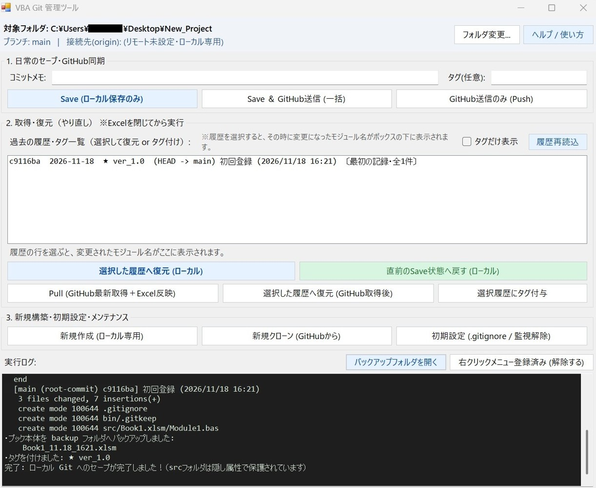

# VBA Git 管理ツール (VbaGitTool) 2026年11月18日

Excel VBA（マクロ）のソースコードを自動でテキスト抽出（.bas / .cls / .frm 等）し、黒い画面（コマンドプロンプトやGitコマンド）を一切使わずに、**マウス操作だけで安全・簡単にGit / GitHubでのバージョン管理（履歴保存・過去の状態への復元）ができるWindows用デスクトップツール**です。

* **インストール不要（ポータブル動作）：** フォルダを任意の場所に置くだけで動作します。
* **管理者権限不要：** 会社の貸与PCなど、制限のある環境でも右クリックメニューへの登録・利用が可能です。
* **ローカル管理に最適化：** 社外秘の社内ツールや個人開発など、GitHubを使わず「自分のPC内（ローカルGit）だけで安全に履歴管理したい」という用途に最も使いやすいUI設計になっています。
* **プログラミングの専門家でなくても使える：** 「3歩進んで2歩戻る」ように、直線的な履歴の中で行ったり来たりしながら開発する使い方を想定しています。難しいGitの概念（ブランチ・マージなど）は、あえて画面に出していません。



### 主な機能

| 機能 | 内容 |
| :--- | :--- |
| **Save（履歴の記録）** | ExcelのVBAコードを抽出し、日時付きのコミットメモとともに履歴へ記録します。 |
| **復元（やり直し）** | 過去の履歴の時点、または直前にSaveした状態へ、VBAコードを戻します。 |
| **履歴の見やすさ** | 各履歴で「どのモジュールが変わったか」を一覧で確認できます。 |
| **タグ（目印）** | 「月次集計の完成」など、日本語の文で目印を付けられます。いつでも削除できます。 |
| **ブック本体のバックアップ** | Saveのたびに、Excelブック本体（シートの内容を含む）を `backup` フォルダへコピーします。 |
| **安全装置** | Excel使用中の検知、保存していない変更の確認、復元前の自動退避などで、うっかりミスから守ります。 |

### 動作環境

| 項目 | 内容 |
| :--- | :--- |
| OS | Windows（.NET Framework 4.x が標準で入っている環境） |
| Excel | VBAマクロを含むブック（.xlsm 等）を扱えるMicrosoft Excel |
| Git | [Git for Windows](https://gitforwindows.org/) |

---

### 💡 【重要】本ツールを使用する際の開発環境について（開発用フォルダと bin フォルダ）

一般的なExcelファイルの使い方とは異なり、本ツールでバージョン管理を行うためには**「開発用フォルダ内の bin フォルダに置いたExcelファイルを直接編集する」**という特有のルールがあります。

**Q.「開発用フォルダ」とは？**
特定のVBAツール（例：「売上集計マクロ」など）に関する履歴やファイル一式を、ひとまとめにして管理するための「作業専用の親フォルダ」のことです。
PC内のどこに作成しても構いません。※具体的な作成手順は後述の **「3-A. 新しいVBA案件の始め方」** をご参照ください。

**Q.「bin フォルダ」とは？**
本ツールの機能を使って新しい案件を作り始めると、開発用フォルダの中に自動的に bin という小フォルダが生成されます。

**開発対象となるExcelファイル（.xlsm 等）はこの bin フォルダの中に配置し、日々そのファイルを開いてVBAのプログラミング（マクロ開発）を進めてください。**
このルールを守ることで、ツールが「どのファイルのVBAコードを抽出してバックアップすればいいか」を正確に自動判別できるようになります。

#### ■ 開発用フォルダの中身

```
開発用フォルダ/
├─ bin/       ← 【あなたが使う】開発対象のExcelファイルを置く場所
├─ src/       ← 抽出されたVBAコード（ツールが自動管理・隠しフォルダ。触らない）
├─ backup/    ← ブック本体のコピーと、復元前の退避（ツールが自動で作成）
├─ .git/      ← 履歴の保管場所（隠しフォルダ）
└─ .gitignore ← Gitの管理から除外するものの設定（自動作成）
```

#### ■ VBAコードがGit/GitHubへ同期され、復元されるまでの全体像

1. **ツールの起動（親フォルダ自動補正機能つき）**
   親フォルダ（開発用フォルダ）内の空白箇所で右クリックをして、本ツールを立ち上げます。
   或いは、開発対象のエクセルファイルと同じ階層（binフォルダの中）から立ち上げることも出来ます。
   ※上記以外の場所から本ツールを立ち上げると、正しく対象ファイルを認識できないので注意して下さい。
2. **コードの自動抽出とGitへの記録**
   本ツールで Save 操作を行うと、bin フォルダ内のExcelファイル（.xlsm 等）にあるVBAコードが、テキストファイル（.bas や .cls 等）として src フォルダに一旦出力され、それらがGit/GitHubのバージョン管理対象として記録されます。
   ※ src フォルダはツールが自動管理する領域であり、ユーザーが誤って直接編集・削除しないよう自動的に「隠しフォルダ」として保護されます。
3. **ブック本体のバックアップ**
   Saveで履歴が記録されるたびに、Excelブック本体のコピーが backup フォルダにも保存されます（シートの内容を昔の状態へ戻したいとき用です。詳しくは「3-E」）。
4. **過去の状態への復元（やり直し）**
   過去の履歴へ戻す（復元する）操作を行うと、親フォルダ内の隠しフォルダ（.git）に保存されている過去のテキストファイルが呼び出され、自動的に bin フォルダ内のExcelファイルへ上書きインポートされる形でコードが修正されます。
5. **複数ファイルの同時管理も安全**
   bin フォルダ内にあるすべてのExcelファイルが自動的に管理対象となります（複数同時管理可）。
   ※ src フォルダ内には「Excelファイル名」ごとの専用フォルダが自動生成され、その中に各コードが整理されて格納されます。
   そのため、別々のExcelファイルに同名のモジュール（例：Module1.bas）があっても、ファイル名に紐付いて保管されるため、中身が混ざったり衝突したりすることはありません。

> **ℹ️ Git/GiHubへのsave/pushはエクセルファイルを開いたままで実行できます。**
> 
> 開発対象のファイルを開いた状態で、本ツールも立ち上げておいてください（立ち上げておいても、バックグラウンドでは何もしていません）。
> 
> 任意のタイミングで本ツールに移動して、Git/GitHubと同期が出来ます（この時エクセルを閉じる必要は有りません / もちろん閉じた状態からでもsave/pushは出来ます）。
> 
> ※エクセルファイルが未保存の状態でsave/pushを実行すると、エクセルファイルを上書き保存するかの確認を求められます。
> 
> ※復元（ロールバック）する場合は、エクセルを閉じた状態で行って下さい。

> **ℹ️ 履歴に記録されるのは「VBAコード」だけです**
> 
> シートのデータ・書式・数式などは、Gitの履歴には含まれません。過去の履歴へ復元しても、戻るのはVBAコードだけで、シートの内容は今のままです。
> 
> シートの内容まで昔の状態を取り出したいときは、Saveのたびに作られる **backup フォルダのブックのコピー** を使います（「3-E」参照）。

---

## 1. 事前準備（必要なソフトとExcelの設定）

本ツールを使用するPCで、最初に1回だけ以下の準備を行ってください。

### ① Git for Windows のインストール
まだPCにGitが入っていない場合は、[Git for Windows 公式サイト](https://gitforwindows.org/) からインストーラーをダウンロードし、標準設定のままインストールしてください。

### ② Excel側のセキュリティ設定（必須）
ツールがExcelからVBAコードを自動抽出・書き戻しできるようにするため、Excelの設定を1箇所変更します。
1. Excelを開き、**「ファイル」** ＞ **「オプション」** を開きます。
2. 左メニューの **「トラスト センター」** ＞ **「トラスト センターの設定」** ボタンを押します。
3. 左メニューの **「マクロの設定」** を選び、下にある **「VBA プロジェクト オブジェクト モデルへのアクセスを信頼する」にチェックを入れて「OK」** を押します。

---

## 2. ツールの導入・セットアップ手順

1. 本ツールの必要ファイル４点（VbaGitTool.cs / vbac.wsf / build.bat / .gitignore ）を、PC内の分かりやすい場所（例：C:\Users\ユーザー名\Tools\VbaGitTool など）に配置します。
2. フォルダ内の **build.bat** をダブルクリックすると **VbaGitTool.exe** が自動生成されます。
3. 生成された **VbaGitTool.exe** をダブルクリックして起動します。
4. 画面下部（実行ログ欄の右上）の **[右クリックメニューに登録する]** ボタンを押します。
   * ボタンの表示が「右クリックメニュー登録済み (解除する)」に変わればセットアップ完了です。
   * これ以降、どのフォルダの余白（またはフォルダアイコン）を右クリックしても **「VBA Git 管理ツールを開く」** が選べるようになります。

#### ※後日、VbaGitTool.cs等を更新した場合は、再度 **build.bat** を実行して **VbaGitTool.exe** を再生成して下さい。

---

## 3. 具体的な使い方・運用フロー

### 3-A. 新しいVBA案件の始め方（初期構築）

#### パターン1：手元のPC内（ローカルGit）だけで管理する場合【推奨・最も一般的な使い方】
1. 案件フォルダを作りたい場所（デスクトップやドキュメントなど）の空白箇所を右クリックし、**「VBA Git 管理ツールを開く」** を選択します。
2. 下部「3. 新規構築・初期設定・メンテナンス」エリアの **[新規作成 (ローカル専用)]** を押し、作成するフォルダ名（例：売上集計マクロ）を入力してOKを押します。
3. 自動的に開発用フォルダと bin フォルダ（および .gitignore 設定）が生成され、ツールの操作対象が新しいフォルダへ切り替わります。
4. 自動生成された **bin フォルダの中に、管理したいExcelファイル（.xlsm 等）を入れます。**
5. 画面上部の **[Save (ローカル保存のみ)]** ボタンを押すと、最初のコード抽出と初期登録が完了します！
   * PCにGitの記録者（名前）がまだ設定されていない場合は、Saveのときに**「記録者の登録」画面**が表示されます（詳しくは「3-B」）。

#### パターン2：GitHubとも連携してクラウドバックアップ・複数PC共有を行う場合
1. WebブラウザでGitHubを開き、新しい空のリポジトリを作成してURL（https://github.com/.../xxx.git）をコピーします。
2. 案件フォルダを作りたい親フォルダで右クリックし、**「VBA Git 管理ツールを開く」** を選択します。
3. **[新規クローン (GitHubから)]** を押し、コピーしたURLとローカルのフォルダ名を入力します。
4. 自動的に生成された **bin フォルダの中にExcelファイルを入れ**、**[Save ＆ GitHub送信 (一括)]** を押せば初期同期が完了します。

---

### 3-B. 日常の開発サイクル（毎日のセーブ）

1. **bin フォルダ内のExcelファイル**を開き、いつも通りVBAコードを編集して上書き保存（Ctrl + S）します。
   ※Excelは開いたままでもSaveできます。
2. 開発用フォルダ（または bin フォルダ内）を右クリックして **「VBA Git 管理ツールを開く」** を起動します。
3. 「1. 日常のセーブ・GitHub同期」エリアの **「コミットメモ」** に、今回の変更内容（例：消費税計算のバグ修正 など）を入力します。
   * 記録されるメモの後ろには、**自動的にSaveした日時が付きます**（例：`消費税計算のバグ修正 (2026/11/18 09:02)`）。
   * 空欄のまま Save すると、**確認ダイアログ**が表示されます。そのまま進むと「作業セーブ (日時)」というメモで記録されます。あとで履歴から目的の状態を探しやすくするため、一言入力しておくことをおすすめします。
4. 用途に合わせてボタンを押します。
   * **普段のローカル保存（青ボタン）：** **[Save (ローカル保存のみ)]** を押します。
   * **GitHubへも同時に送る場合：** **[Save ＆ GitHub送信 (一括)]** を押します。

#### ■ Saveのときに表示されることがある画面

| 画面 | 表示されるとき | 内容 |
| :--- | :--- | :--- |
| **記録者の登録** | PCにGitの記録者が未設定のとき（1度登録すれば次回から不要） | 履歴に残る「記録者名」を登録します。メールアドレスは任意です（空欄なら仮のアドレスが使われます）。GitHubへ送信すると、この名前はGitHub上でも見える情報になります。 |
| **コミットメモの確認** | コミットメモが空欄のとき | メモなしで続けるか、入力してからSaveするかを選びます。既定は「いいえ（中止）」です。 |
| **Excelに保存していない変更があります** | Excelでブックを編集し、まだ上書き保存していないとき | 「はい」でツールがブックを上書き保存してから Save します。「いいえ」は保存せずに今ディスクにある状態で Save します。「キャンセル」で中止します。 |
| **Excelの状態を確認できません** | Excelがセル入力中、またはメッセージを表示中のとき | 保存していない変更があるか確認できないため、Excelに戻って入力の確定（Enterキー）やメッセージを閉じてから、もう一度Saveするよう案内します。 |

> **💡 補足：Excelで編集したのに、VBAコードに変更がなかったとき**
> シートのデータだけを更新して、VBAコードに変更がない場合は、履歴は新しく作られません（ブック本体のバックアップも作られません）。本ツールはVBAコードのバージョン管理が目的のためです。

---

### 3-C. コードを壊してしまった時・過去の状態に戻す方法（復元）

> **⚠️ 重要（安全装置について）**
> 復元やPullを行う際は、**必ず事前にExcelファイルを閉じてください。**
> Excelが開いたままだと安全装置が働き、警告メッセージが出て処理が自動ストップします。また、復元処理の直前には現在の src と bin の中身が **backup\restore_日時** フォルダへ自動退避（直近10回分保持）されるため、万一の際も元のデータを失いません。

#### ■ 履歴一覧の見方

「2. 取得・復元」エリアの **「過去の履歴・タグ一覧」** には、直近30件の履歴が新しい順に表示されます。

```
624ea93  2026-11-16  ★ 月次集計の完成  (HEAD -> main) 関数を整理 (2026/11/16 09:02)  〔3件〕
```

| 表示 | 意味 |
| :--- | :--- |
| `624ea93` | 履歴のID（短縮形） |
| `2026-11-16` | 記録した日付 |
| `★ 月次集計の完成` | その履歴に付けたタグ（目印）。詳しくは「3-D」 |
| `(HEAD -> main)` | 現在の位置など、Gitの状態を表す表示 |
| `関数を整理 (2026/11/16 09:02)` | コミットメモと、Saveした日時 |
| `〔3件〕` | その履歴で**変更されたモジュールの数**。`〔VBA変更なし〕`（設定ファイルなどの変更のみ）や `〔最初の記録・全12件〕` と表示されることもあります |

**履歴の行を選択すると、一覧の下に、その時に変更になったモジュール名が表示されます。**（例：`変更: Module1, Sheet1 / 追加: Module5 / 削除: Module3`）
どの履歴に戻るべきか迷ったときの手がかりにしてください。

#### ■ 昨日や先週など、特定の履歴・タグ時点に戻したい時（最も使う復元）
1. Excelを閉じます。
2. 「2. 取得・復元」エリアの **「過去の履歴・タグ一覧」** から、戻したい日時の行をクリックして選択します。
3. 青色の **[選択した履歴へ復元 (ローカル)]** ボタンを押します。
4. 指定した時点のVBAコードがExcelファイルへ自動的に書き戻されます。Excelを開いて動作を確認し、「この巻き戻した状態を最新の正として確定させたい」場合は、再度 **[Save (ローカル保存のみ)]** を押してください。

#### ■ さっきSaveした直前の状態にすぐリセットしたい時
1. Excelを閉じます。
2. 緑色の **[直前のSave状態へ戻す (ローカル)]** ボタンを押します。
3. いま編集している未保存の変更が破棄され、最後に Save した時点の綺麗な状態へExcelブックが復元されます。

#### ■ 古いコードの一部だけ取り出したい時（「この関数だけ昔のものを使いたい」）

本ツールには、モジュールだけを部分的に戻す機能は**ありません**。一部だけ古いコードが混ざると、誰も動かしたことのない状態になり、動かなくなったときに原因が分かりにくくなるためです。代わりに、次の手順でVBAエディタからコピーします。

1. まず、今の状態を **[Save]** して記録しておきます。
2. 一覧から欲しいコードがある行を選び、**[選択した履歴へ復元 (ローカル)]** を押します。
3. Excelを開き、VBAエディタ（Alt + F11）で、欲しいコードをコピーします。
4. Excelを閉じてから、**[直前のSave状態へ戻す (ローカル)]** を押し、元の状態に戻します。
5. Excelを開いて、コピーしたコードを必要な場所へ貼り付け、動作を確認してから **[Save]** します。

※手順1の Save を忘れると、手順4で戻る先がなくなります（その場合も、backup フォルダの `restore_日時` に退避が残っています）。

---

### 3-D. タグ（目印）を付けるタイミングと使い方

「タグ」は、Git・GitHubにもある**同じ名前の機能**です（GitHub上では「Tags」に表示されます）。本ツールでは、**日本語の文章で自由に**付けられます（100文字以内）。

**「選択履歴にタグ付与」**（またはSave時の「タグ(任意)」欄）は、毎日の細かいSaveで使うものではありません。
**「月次集計の完成」「営業部へ配布した安定版」「年末の仕様変更を入れる直前」など、後から一発で見つけ出したい重要な節目（マイルストーン）に目印を貼る機能**です。

#### ■ タグを付ける
* **Saveと同時に付ける：** 「1. 日常のセーブ」エリアの **「タグ(任意)」** 欄に文を入力してSaveします。
* **後から付ける：**
  1. 「過去の履歴・タグ一覧」から、目印を付けたい履歴の行を選択します。
  2. **[選択履歴にタグ付与]** ボタンを押し、表示された入力欄にタグの文を入力して **[OK]** を押します。
* タグを付けた履歴は、一覧で **`★ 文`** のように目立つ表記になり、何十個も履歴が増えた後でも「あの時の完成版」がすぐ見つかります。
* GitHubにもタグを反映させたい場合は、付与した後に **[GitHub送信のみ (Push)]** を押してください。

#### ■ タグだけを一覧で見る
一覧の見出しの右にある **[タグだけ表示]** にチェックを入れると、**タグを付けた履歴だけが、古いものも含めて全部**表示されます（通常の一覧は直近30件までです）。ここから行を選んで、そのまま復元できます。チェックを外すと通常の一覧に戻ります。

#### ■ タグを削除する
新しいボタンはありません。付与のときと同じ操作で削除できます。
1. 一覧から、タグを削除したい行を選びます。
2. **[選択履歴にタグ付与]** を押し、表示された入力欄を**空欄のまま** **[OK]** を押します。
3. 削除するタグの一覧が確認として表示されます。よければ **[はい]** を押します。

* 削除されるのは目印のタグだけで、**履歴（VBAコードの記録）は消えません。**
* その行に複数のタグが付いているときは、すべて削除されます。
* GitHubへ送信済みのタグは、**GitHub側からも削除**されます（通信できないときは、このPCだけ削除するかを確認します）。
* 別のPCにクローンしてある場合、そのPC側のタグは消えません。

---

### 3-E. シートの内容を昔の状態に戻したい時（ブック本体のバックアップ）

Gitの履歴にはVBAコードしか入っていないため、シートのデータや書式を昔の状態に戻したいときは、**Saveのたびに自動で作られるブック本体のコピー**を使います。

#### ■ バックアップの仕組み
* 履歴が記録されるたびに、bin フォルダ内のExcelブックが、**backup フォルダの直下**にコピーされます。
* ファイル名の末尾に、**Saveした月日と時刻**が自動で付きます。

  `給油集計表（2026年度）.xlsm` → `給油集計表（2026年度）_01.06_0902.xlsm`
  （1月6日 9時02分にSaveしたときのブック。`_` 以降はすべて半角）
* コミットメモ末尾の日時（例：`(2026/01/06 09:02)`）と、ファイル名の日時が一致するので、履歴一覧の行と見比べられます。
* **ブックごとに最新10回分**だけ保持され、古いものは自動で削除されます。
* 同じ分に続けてSaveした場合は、最新のものだけが残ります。
* backup フォルダは Git の管理から自動的に除外されます（履歴には含まれません）。
* backup フォルダの合計が約1GBを超えると、実行ログに警告が出ます。ブックのサイズが大きい場合は、不要な古いファイルを手で削除してください。

#### ■ 取り出し方
1. 画面下部（実行ログ欄の右上）の **[バックアップフォルダを開く]** を押します。
2. 戻りたい日時のブックを開き、必要なシートやセルを、今のブックへコピーして貼り付けます。

※バックアップのブックは、直接開いて上書き保存せず、別の場所へコピーしてから開くことをおすすめします。
※取り出したブックを bin に入れて使う場合、名前の末尾の `_月.日_時分` は残したままで構いません（次のSaveのときに、新しい日時へ自動で付け替えられます）。

---

## 4. ボタン機能一覧（クイックリファレンス）

| エリア | ボタン名 | 主な役割・使うタイミング |
| :--- | :--- | :--- |
| **上部** | **フォルダ変更...** | ツールを起動したまま、別の案件フォルダへ操作対象を切り替えます。 |
| **上部** | **ヘルプ / 使い方** | ツール内でいつでも読める操作ガイド画面を開きます。 |
| **1. セーブ** | **Save (ローカル保存のみ)** | **[日常のメイン操作]** bin 内のExcelからVBAを抽出し、PC内のGitに履歴を保存します。ブック本体のバックアップも作成します。 |
| **1. セーブ** | **Save ＆ GitHub送信 (一括)** | ローカルへのSaveと、GitHubへのバックアップ送信をワンクリックで連続実行します。 |
| **1. セーブ** | **GitHub送信のみ (Push)** | ローカルに溜まっている履歴や、後から付けたタグをGitHubへ送信します。 |
| **2. 復元** | **履歴再読込** | 履歴一覧の表示を最新の状態に更新します。 |
| **2. 復元** | **タグだけ表示（チェック）** | タグを付けた履歴だけを、古いものも含めて全部表示します。 |
| **2. 復元** | **選択した履歴へ復元 (ローカル)** | **[復元のメイン操作]** 一覧で選んだ過去の履歴時点へExcelのVBAコードを戻します。 |
| **2. 復元** | **直前のSave状態へ戻す (ローカル)** | 作業中にコードが動かなくなった時など、直前にSaveした状態へ即座にリセットします。 |
| **2. 復元** | **Pull (GitHub最新取得＋Excel反映)** | 別PC等でGitHubにアップされた最新コードを取得し、手元のExcelへ反映します。 |
| **2. 復元** | **選択した履歴へ復元 (GitHub取得後)** | GitHub上の最新情報を取得（fetch）した上で、選択した履歴へExcelを復元します。 |
| **2. 復元** | **選択履歴にタグ付与** | 重要な節目の履歴に、日本語の文で目印（タグ）を付けます。**入力欄を空欄のまま [OK] を押すと、その履歴のタグを削除**します。 |
| **3. 構築** | **新規作成 (ローカル専用)** | Git未初期化の親フォルダ内に、ローカル管理用の新しい案件フォルダ一式を自動生成します。 |
| **3. 構築** | **新規クローン (GitHubから)** | GitHubのリポジトリURLから、新しい案件フォルダ一式をダウンロードして構築します。 |
| **3. 構築** | **初期設定 (.gitignore / 監視解除)** | Gitの管理対象から除外するファイル設定（.gitignore）の編集と監視解除を行います。 |
| **下部** | **バックアップフォルダを開く** | Saveのたびに作られるブック本体のコピー（backup フォルダ）をエクスプローラーで開きます。 |
| **下部** | **右クリックメニュー登録 / 解除** | Windowsのエクスプローラー右クリックメニューへの登録・解除をワンクリックで切り替えます。 |

> ※GitHubのリモートが設定されていないフォルダ（ローカル専用）では、GitHubに関するボタン（送信・Pull・GitHub取得後の復元）は自動的に無効になります。

---

## 5. 安全装置と、自動で行われる処理

本ツールは、うっかりミスでデータを失わないよう、次の処理を自動で行います。

| 処理 | 内容 |
| :--- | :--- |
| **Excel使用中の検知** | 復元・Pull のときに、bin フォルダ内のExcelが開かれていたら、警告を出して処理を止めます。 |
| **保存していない変更の確認** | Save のときに、Excelに保存していない変更があれば、先に保存するかを確認します。 |
| **復元前の自動退避** | 復元・Pull の直前に、現在の src と bin を `backup\restore_日時` へ退避します（直近10回分）。 |
| **ブック本体のバックアップ** | Save のたびに、ブックのコピーを `backup` フォルダへ保存します（ブックごとに最新10回分）。 |
| **コミットメモの確認** | メモが空欄のとき、そのまま進めるかを確認します（既定は中止）。 |
| **記録者の登録** | 記録者が未設定のとき、Save の時点で、履歴に残る記録者名を登録します。 |
| **src フォルダの保護** | VBAコードの格納場所を自動的に隠しフォルダにして、誤編集を防ぎます。処理の間だけ一時的に解除します。 |
| **.gitignore の自動管理** | bin 内のExcelファイル、一時ファイル、backup フォルダが、Gitの履歴に入らないよう除外します。 |
| **親フォルダの自動補正** | bin フォルダの中から起動しても、1階層上の開発用フォルダを自動で認識します。 |
| **処理中の操作ロック** | Git操作の実行中は、フォルダ変更や画面を閉じる操作を受け付けません。 |

---

## 6. 制限事項・よくある質問

**Q. シートのデータや書式は、履歴に入りますか？**
入りません。Gitの履歴に記録されるのはVBAコードだけです。シートの内容は、`backup` フォルダのブックのコピーから取り出してください（「3-E」参照）。

**Q. モジュールを個別に昔の状態へ戻せますか？**
意図的に搭載していません（「3-C」の「古いコードの一部だけ取り出したい時」に、代わりの手順があります）。モジュールごとに状態がばらばらになると、動かなくなったときに原因を特定しにくいためです。

**Q. ブランチやマージの機能はありますか？**
搭載していません。「変更する → 成功したら先に進む → 失敗したら変更前に戻る」という、直線的な履歴で行ったり来たりしながら開発する使い方を想定しています。

**Q. Excelの保存確認が働かないことがあります。**
次のような場合、ツールからExcelの保存状態を確認できないことがあります。
* OneDrive や SharePoint 上のフォルダに置いたブック
* 保護ビューで開いているブック

この場合も、Excelが開いていることは検知して案内が出ます。Ctrl + S で上書き保存してから Save してください。

**Q. Excelでセルを入力している最中に Save を押したら、警告が出ました。**
Excelがセル入力中やメッセージ表示中のときは、保存していない変更があるか確認できません。Excelに戻って入力を確定（Enterキー）するか、メッセージを閉じてから、もう一度 Save してください。

**Q. ビルド（build.bat）に失敗します。**
VbaGitTool.exe が起動したままだと、上書きできずに失敗します。ツールを閉じてから、もう一度実行してください。

---

## 7. ライセンス・クレジット・免責事項

### ■ 同梱スクリプト（vbac.wsf）について
本ツールがExcelファイルからのVBAコード抽出・結合に使用している vbac.wsf は、オープンソースのVBAライブラリプロジェクト **「Ariawase」**（作者：igeta 様）の成果物であり、**MIT License** のもとで公開・配布されています。
ライセンスの全文は、同梱の `LICENSE-Ariawase.txt` をご参照ください。
* オリジナルリポジトリ: [vbaidiot/Ariawase (GitHub)](https://github.com/vbaidiot/Ariawase)

### ■ 本ツール（VbaGitTool）のライセンス
本ツール自体のソースコード（VbaGitTool.cs 等）およびドキュメントは **MIT License** のもとで公開されています。商用・非商用を問わず、自由にご利用・改変・再配布いただけます。

### ■ 免責事項
本ツールは万一のトラブルに備え、復元時等の自動退避（backup フォルダ）、Save時のブック本体のバックアップ、Excel起動中チェックなどの安全装置を備えていますが、本ツールの使用によって生じたいかなる損害（データの消失・破損、業務の停止等）についても、作成者は一切の責任を負いません。重要なExcelファイルについては、利用者ご自身の責任において定期的なバックアップを行ってください。

---

## 更新履歴

* **2026年11月18日**
  * コミットメモ：空欄のときの確認を追加。メモの後ろに、Saveの日時を自動で付与。
  * 記録者（名前・メールアドレス）の初回登録画面を追加。
  * Saveのたびに、ブック本体を `backup` フォルダへコピー（`ブック名_月.日_時分`、ブックごとに最新10回分）。復元前の退避も `backup` フォルダへ集約。
  * Save前に、Excelに保存していない変更があれば、保存するかを確認。
  * 履歴一覧に、変更されたモジュールの数と名前を表示。
  * タグを、日本語の文で付けられるように強化。一覧に `★` で表示。**[タグだけ表示]** を追加。**空欄のまま [OK] でタグを削除**できるように。
  * 「古いコードの一部だけ取り出したい時」の手順を、ヘルプに追加。
  * 画面の自動レイアウト化（画面の大きさ・文字の大きさが変わっても、文字が切れない）。
* **2026年11月16日**
  * 初版。
